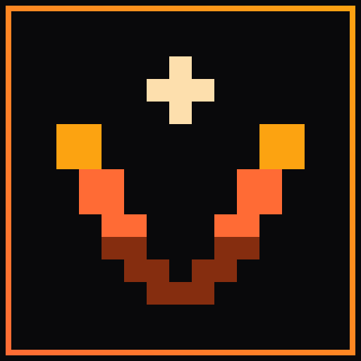
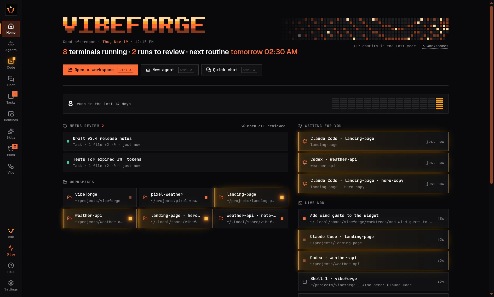

<p align="center">
  
</p>

<h1 align="center">VibeForge</h1>

<p align="center">
  <strong>Your coding agents, forged into one desk.</strong><br>
  An open-source desktop for <a href="https://omarchy.org">Omarchy</a> that runs Claude Code, Codex, Grok and the other coding CLIs you already use, side by side in real terminals.
</p>

<p align="center">
  <a href="https://vibe-forge.net"><strong>vibe-forge.net</strong></a>
</p>

<p align="center">
  <a href="LICENSE"></a>
  
  
</p>

<p align="center">
  
</p>

---

VibeForge never calls a model API and never holds a key. Every engine is a CLI you are already signed in to; VibeForge gives them a home. It remembers **who** does the work (agents with a brief, memory and skills), **where** they may work (allowed folders), **when** work starts (routines), and **what to review** when it ends (every run keeps its final screen, a transcript and the git diff since it began). No accounts. No telemetry. Everything on disk is plain YAML and Markdown. What it will and won't do is in [the principles](docs/principles.md).

## Install

On Omarchy (or any Arch + Hyprland setup):

```bash
curl -fsSL https://vibe-forge.net/install | bash
```

Then open **VibeForge** from the app launcher (<kbd>Super</kbd> + <kbd>Space</kbd>) or run `vibeforge`. Add `--uninstall` to remove the command, the launcher entry and Start at login; it lists what stays (your data, the app's folder, its browser profile) so you can delete those too.

The installer downloads the newest [release](https://github.com/L0nE-F0x/VibeForge/releases)'s ready-made build (about 100 MB), checks it against the release's `SHA256SUMS`, unpacks it into `~/.local/share/vibeforge-app`, and adds `~/.local/bin/vibeforge` and a desktop entry. Nothing is compiled: it needs `curl`, `tar`, `zstd` and `sha256sum`, which every Arch install has, and Node 20 or newer for the terminals (Omarchy ships mise: `mise use -g node@lts`). An update downloads the new release's build the same way, unpacks it beside the installed copy and swaps it in only once it is whole and its checksum matches, so a dropped connection or a bad download leaves VibeForge as it was; the copy it replaced stays in `~/.local/share/vibeforge-app.previous`. If GitHub answers with an error, it stops and says so. Run it again with the newest release already installed and it downloads nothing (`VIBEFORGE_FORCE=1` installs it again).

It builds from source instead (a clone, `npm ci` and a build, which need `git`, `base-devel`, `python` and Node 20.19+ or 22.12+) when the release has no ready-made build or none for your CPU (there is one for x86-64), when the ready-made terminal engine won't load on your system (an older glibc), when you set `VIBEFORGE_FROM_SOURCE=1`, or with `VIBEFORGE_BRANCH=main` to follow the main branch. It says which way it went. `VIBEFORGE_VERSION=vX.Y.Z` installs that release instead of the newest.

**Updating.** VibeForge asks GitHub for the newest release number when it starts and every six hours (nothing else is sent; turn it off in Settings → Updates). When one is out, Help in the rail gets a dot: **Update** shows the release notes, downloads that release's `install.sh` from GitHub, checks it against the SHA-256 GitHub lists for it, runs it in a terminal you can watch, then restarts. Running the install command again does the same. Each release's files carry a signed build provenance attestation from the GitHub Actions run that built them: `gh attestation verify <file> --repo L0nE-F0x/VibeForge` checks one.

<details>
<summary>Build it yourself</summary>

```bash
git clone https://github.com/L0nE-F0x/VibeForge.git
cd VibeForge
npm install
npm start           # development: Vite + Electron with hot reload
npm run build       # production build, when you want it now
./scripts/vibeforge # builds when this checkout is newer, then opens the window
```

</details>

## Which one do I use?

What you want, and where to do it. The welcome tour shows the same list, and so does **Help → Which one do I use?** in the rail, where each place is a link.

| You want | Use |
| --- | --- |
| A quick question, no project | **Chat** |
| Work in a project while you watch: type `claude` or any CLI in a terminal | **Code**, where each CLI you type is kept as a run |
| An agent's work in its own copy, brought back for review | **Tasks**: **Execute** starts it, **Apply** brings its changes in |
| An agent's job on a schedule | **Routines** |
| A teammate with a brief, memory and skills | **Agents** · **Skills** |
| Say or type what to start, make or change, and have it done | **Viby**, or <kbd>Ctrl</kbd>+<kbd>Shift</kbd>+<kbd>O</kbd> from any view |
| Talk it through out loud, hands-free: **Ask**, then **Call Viby** (<kbd>Ctrl</kbd>+<kbd>Shift</kbd>+<kbd>L</kbd>) | **Viby** answers aloud and listens again until you hang up ([how](#voice)) |
| One CLI asking another, or handing an agent a task: `vibeforge tell`, `vibeforge task` | **Settings → Agents together**, which can also make one CLI [the lead](#agents-together) |
| Look back at a session, then Continue it or Hand it off to an agent | **Runs** |
| Start and steer CLIs from the couch, on your phone | **Settings → Phone** ([how](#phone)) |
| The same workspace on your other machine | **Settings → Sync** ([how](#sync)) |
| Dictate to an agent from any app: hold <kbd>Super</kbd>+<kbd>Alt</kbd>+<kbd>V</kbd> | **Settings → Voice**, which adds the key to Hyprland |

## What's inside

| View | What it is for |
| --- | --- |
| **Home** | Who is waiting for you, by name, and what is waiting its turn; what's live, what finished and needs review, what fires next, and a year of your commits drawn in pixels. |
| **Agents** | Named teammates with a brief, memory, skills and allowed folders. Chats with an agent are real terminals. Switch its engine from Claude to Codex to Grok and the teammate stays the same. |
| **Code** | A workspace with tiled terminals that you can split, drag to rearrange and maximize, a file tree that inserts paths, and a browser beside them: click an http(s) link in a terminal (your dev server's, say) and it opens there, each workspace keeping its own page. Type `claude`, `codex` or any CLI in a terminal: its title bar says so, and from the moment it starts until you're back at the prompt it is recorded as a run (transcript and git diff). A terminal whose CLI goes quiet or finishes while you're looking elsewhere glows like an ember until you focus it, and so do its workspace and Code's icon in the rail. Looking at one terminal leaves the others glowing. Each title bar says which other coding CLIs are in the same folder. In a split, the terminals you aren't typing in dim a little. Drag workspaces to reorder them and jump between them with <kbd>Alt</kbd>+<kbd>1</kbd>…<kbd>9</kbd>. A long list can be searched (by name, folder or git branch), filtered (terminals open, CLI working, waiting for you, copy waiting for review, uncommitted changes, synced; the filters combine), sorted (your order, name, parent folder, recent activity, uncommitted changes) and grouped by parent folder, and **Select** removes several at once. **Open another branch**, on a workspace's menu, checks that branch out beside the project and opens it as its own workspace. The folder you already have stays on its branch, and removing the new workspace later leaves its folder on disk. Layouts are remembered per workspace. |
| **Chat** | Throwaway conversations in an empty scratch folder. |
| **Tasks** | A board. Writing or assigning a task starts nothing; **Execute** does. A finished run lands in Review with its diff. A new task in a git workspace starts with **Work in a separate copy** on: the agent works in its own git worktree on a `vibeforge/<task>` branch, so it never touches the folder you or another agent are in; **Apply** brings its changes into the workspace as uncommitted edits (conflicts are marked, as a merge would) and removes the copy. In the workspace itself, a task takes turns: while another coding CLI is busy in that folder, Execute waits and starts on its own once that CLI has been quiet for half a minute (or start it now, in a copy or anyway). **Hand off**, on a finished run, makes a To do task for another agent from it. |
| **Routines** | Cron or interval schedules that open a fresh agent run while VibeForge is running, in the tray too. A due routine takes turns like a task: it waits while another coding CLI is busy in its folder. Missed slots are shown, never replayed. A routine whose last three runs failed glows here and on Home until one succeeds. |
| **Skills** | Reusable `SKILL.md` procedures you install on agents. |
| **Viby** | VibeForge's orchestrator: tell it what to start, typed or spoken, and it sets it up. It can do the rest of what you'd click, too. See [Viby](#viby). |
| **Runs** | Every CLI you typed into a terminal and every process VibeForge started, a day at a time: final screen, transcript, prompt, and the full diff since it began, saved the moment it ended so later edits stay out of it. **Continue** reopens the exact session. Search finds a run by what it said, not only its title: the words around the match are shown, and <kbd>Ctrl</kbd>+<kbd>K</kbd> lists those runs too. **Copy as Markdown** in its ⋯ menu gives you the prompt, how it ended and its patch, ready for an issue or a pull request. **Review** opens what finished and is waiting for you, one run after another; **Mark all reviewed** clears the whole list without opening them. |

The pulse at the bottom of the rail counts the terminals running and, underneath, six squares that follow whichever coding plan is closest to its limit. Click it for **plan limits**: each signed-in plan's windows (Claude's 5-hour and 7-day, Grok's credits by product, Gemini's 5-hour, 7-day and Gemini 4 Argon, Kimi's weekly and 5-hour, Codex's and Muse's 5-hour and weekly) with the time until they reset, the last day as a line, and when you'll run out at the current pace. A plan you aren't signed in to stays off the list, and one you sign in to appears on the next refresh. The **Tokens** tab has each CLI's tokens today, over the last 7 and 30 days, and all time, read from the logs Claude Code, Codex, Grok Build, Antigravity CLI, Gemini CLI, Kimi Code, Muse Code, OpenCode and Copilot CLI already keep on this machine; nothing is sent anywhere for those. Cursor Agent and Crush don't keep token counts that can be added up, so they don't appear. The CLIs clear their old logs, so VibeForge keeps each day's count (`~/.local/share/vibeforge/usage-days.json`) and all time keeps growing after they do.

Plan limits are off until you turn them on in Settings → Usage and activity. VibeForge then asks Anthropic, xAI, Google, Moonshot, OpenAI and Meta, at most every 3 minutes, with the sign-in each CLI already saved on this machine. It reads that sign-in for each request and never renews, rewrites or keeps it; when one has expired, the last numbers stay up until you next open that CLI. Codex's and Muse's limits also come from their own logs, with no network. Only the percentages are saved (`~/.local/share/vibeforge/plans.json`). Settings can also notify you as a window passes 80%, 95% and 100%, once per step until it resets; that's off, since Omarchy's own usage widget may already tell you.

The graph on Home is your commits in your workspaces, read with git. If you'd rather see your GitHub contribution graph, pick **GitHub** in Settings → Usage and activity: VibeForge then asks GitHub for it through the `gh` CLI you're signed in to, at most every 30 minutes, and keeps no token. That's off until you choose it.

It keeps your place. Each view reopens where you left it, the same agent, chat or task with its list scrolled where it was, including after a restart. A half-written message or an unsaved brief, task or skill waits for you until you send it, save it or press **Discard**. <kbd>Ctrl</kbd>+<kbd>K</kbd> (or the logo at the top of the rail) jumps to any agent, chat, workspace, task, routine or skill by typing part of its name, to a task, routine or skill by something it says, or to a run by something it said. Deleting a chat, task, skill or routine happens at once, with **Undo** on the toast (or <kbd>Ctrl</kbd>+<kbd>Z</kbd>) for a few seconds; only one that is still running asks first.

When an agent or CLI goes quiet while you're looking elsewhere, or sits on a question when it starts (trust this folder? sign in?), it glows until you look: its terminal and workspace in Code, the agent and its chat in Agents, a row under **Waiting for you** on Home, and a dot on the rail. Short tones, made on your machine, say the same: two soft knocks when it's your turn, a rising chime when a task, routine or typed CLI finishes, a lower one when it fails, and a chirp when dictation starts and stops. By default they play only while VibeForge is in the background, never while Omarchy's Do Not Disturb is on (voice aside), and each one can be turned off or previewed in **Settings → Sounds**.

It lives in the tray, next to Steam and the rest in Omarchy's bar (right-click the tray's arrow to pin it to the bar itself). A click opens the window; right-click for sounds, notifications, **Start at login, in the tray**, and Quit. The icon wears your theme's colours, as the one in notifications and the app launcher does, and gets a corner in its accent while something is waiting for you, and the menu lists who, each opening right where it waits. Closing the window leaves VibeForge running there, so terminals keep going and routines keep firing; **Settings → Tray and startup** changes any of that. Start at login adds an entry to `~/.config/autostart`, the same way Omarchy starts other tray apps, and is off until you turn it on.

It looks like the rest of Omarchy: square corners, JetBrains Mono with Geist headings, flat panels and pixel art, with light kept for what's alive: a working CLI is a slow ember, and one waiting for you glows. It wears your Omarchy theme: colours come from the active theme (`colors.toml` plus the ghostty palette for terminals) and change live when you switch themes, pixel wordmark included, and so does VibeForge's icon in the tray, in notifications and in the app launcher. Rather keep one? Settings → Appearance can pin any installed theme or any of Omarchy's stock themes, which VibeForge ships, so they work on other desktops too.

It speaks English, Deutsch, Español, Français, Português (Brasil), 日本語 and 简体中文, following your system language unless you pick one in Settings. The whole window is translated, errors included, and so are the tray menu, the quit question, desktop notifications, schedule descriptions and git's change summaries. Translations live in `src/ui/i18n/`, one file per language, and the typecheck fails if one is missing a line.

## Works with

Anything with a command line. The defaults know how to hand a first prompt to **Claude Code**, **Codex**, **Grok**, **Cursor Agent**, **Antigravity CLI**, **OpenCode**, **Copilot**, **Muse** and **Pi** as an argument, and paste it into **Kimi**, **Crush**, **Hermes** or any other CLI once it's ready. Add your own in Settings or in `~/.config/vibeforge/engines.json`:

```json
{ "id": "claude", "label": "Claude Code", "bin": "claude", "args": [],
  "promptArgs": ["{prompt}"], "continueArgs": ["--continue"] }
```

`args` are always passed. `promptArgs` puts the first message on the command line (`{prompt}` is replaced); leave it out and VibeForge pastes the message once the CLI is ready. `continueArgs` reopens the CLI's latest session in a folder — and when a CLI prints its own resume line on exit (`claude --resume <id>`, `grok --resume <id>`, `codex resume <id>`, `agy --conversation <id>`), **Continue** uses that exact session instead.

## How it works

```
React UI ──IPC──▶ Electron main ──JSON lines──▶ PTY host (system Node)
                  agents, chats, tasks,          node-pty + a headless xterm per
                  routines, runs, scheduler      terminal → your CLIs
```

- **The PTY host** owns every terminal. It mirrors each screen in a headless xterm, so a view that reattaches redraws exactly; it pastes prompts only once a CLI has gone quiet; and when a run ends it writes the final screen, a plain-text transcript and a capped raw scrollback. Stopping hangs up the process group (SIGHUP → SIGTERM → SIGKILL), like closing a terminal window.
- **One writer for run state**: `meta.json` in each run folder plus a SQLite index, with change events pushed to the UI.
- **Login-shell PATH**: VibeForge asks your login shell for `PATH` at start, so CLIs installed with mise or into `~/.local/bin` are found however it was launched.
- **Allowed folders are a policy, not a sandbox.** Runs start inside them and the prompt tells the CLI to stay there, but a coding CLI has a shell.

## Agents together

Two CLIs open side by side can work together. Every VibeForge terminal has a `vibeforge` command on its PATH, so a CLI can run it with its own shell tool:

```sh
vibeforge who                                   # the CLIs open now, and the agents you can hand tasks to (by id)
vibeforge tell codex "Can you check the migration in db/?"
vibeforge tell codex --wait "Is this regex safe?"   # prints Codex's answer
vibeforge task helper "Write tests for src/parse.ts"
```

`tell` pastes the message into the other CLI once it is free, labelled with who sent it and how to answer. With `--wait` the answer comes back to the one who asked: from the CLI's own session log for Claude Code, Codex, Grok Build and Kimi Code, and from its screen for the rest. If the answer takes longer than the wait (9 minutes unless `--timeout` says otherwise), it arrives later as a message. `task` hands a VibeForge agent a task that runs in its own git copy of the workspace, never in the folder of the CLI that asked. When the agent finishes its turn, the CLI that asked gets a report as a message: what the agent said, its changes as a patch file with the files listed, and where its copy is (or that it ended without answering). A person still applies the changes, and a task handed out this way can't hand out more. Agents that VibeForge starts are told these commands exist, and so are Claude Code, Codex and Grok Build when a Code pane starts them (added to their own instructions: `--append-system-prompt`, `developer_instructions` unless your Codex config sets its own, `--rules`). Other CLIs, and one you type into a shell yourself, learn them from the first message they get, or from `vibeforge help`.

**A lead.** Settings → Agents together can make one CLI the lead in Code (Claude Code, say). A Code pane that starts it tells it your team: the agents allowed in that workspace, with the one-line **Good at** and the **Cost** (Cheap, Everyday, Strong) from each agent's Settings tab. It hands out parts of the work when another agent is better or cheaper for them, or when parts can run at once, and does the rest itself. Under **Ask first** (the default) a task any CLI hands out waits for you: its title bar shows "N to start". Under **Go ahead** tasks start at once, up to a number working at once and a number per message from you; past that they wait for you too. With **Let it apply its helpers' changes** on, the CLI that handed a task out can run `vibeforge apply <task>`; otherwise you apply them from the task. A helper that stops at a question for a person (a folder-trust prompt, say) is reported as waiting, not as finished.

In Code, the send button on a terminal's title bar does the same by hand: **Send to…** puts that CLI's last answer, the text you selected or its changes into another CLI's prompt for you to read and send, and **Ask … to review its changes** has the other CLI review this one's diff when its turn ends and sends the review back (one round, or more in Settings). Two CLIs can trade 8 messages before the next one waits in the prompt for you to press Enter; typing in either terminal starts the count again. The title bar shows who a CLI is talking with, and its stop button ends it until you type there. **Settings → Agents together** turns it off or changes the limits.

## Viby

Viby is VibeForge's orchestrator: you talk to VibeForge itself. Type or say something like *"Start Claude Code in VibeForge on a new branch called fix-tray and make the tray icon pulse, and start Grok in Dune to write tests for the parser"*, in **Viby** in the rail, from any view with **Ask** at the foot of the rail or <kbd>Ctrl</kbd>+<kbd>Shift</kbd>+<kbd>O</kbd> (hold <kbd>Ctrl</kbd>+<kbd>Shift</kbd>+<kbd>Space</kbd> in its box to dictate), or from your [phone](#phone). One of your own CLIs turns that into a plan: Grok Build, Claude Code, Codex or Antigravity CLI, whichever you pick (Settings → Viby; until you pick, Grok Build when it's installed, else the first of them that is, with a **Model** to plan with: its default, one from the list it gives, or a name you type). It plans in one short turn that can't change anything (tools off, a read-only sandbox, or plan mode), on that CLI's own plan, so there is no API key and no model to download. VibeForge then does the work itself: each CLI starts in its own copy of the workspace on the new branch (a git worktree in VibeForge's data folder, opened as its own workspace), with the instruction written out for it, in a Code pane. Your folder stays on its branch. When a CLI is done, its plan card and Viby's **To review** list show its changes: **Apply** brings them into your workspace as uncommitted edits and tidies the copy, its branch and its workspace away; **Discard** drops them, with Undo.

A plan shows as a card first: each step's CLI, workspace, branch, model, effort and instruction, which you can change or drop before **Go**. **Just go** in Settings starts plans at once; a step with something missing (a workspace or CLI that isn't here) still waits for you, and so does anything risky: stopping, applying or throwing away work, deleting, a shell command other than tests, a build, reading git or making folders, <kbd>Ctrl</kbd>+<kbd>C</kbd>, a download, or a setting that turns something networked on. Typed, its answers are text; on a [call](#voice) Viby speaks them. The **Running** list beside the conversation has every coding CLI that's open, the ones it started marked, each with Open and Stop, and **Stop all** for its own. The conversation is kept across restarts until you press **New**. It starts only the CLIs and saved agents you name; when you don't name one, it uses your **Default engine** (Settings), and the card shows which before Go.

What else it can do:

- **Make a workspace.** *"Make a workspace called Star Ledger, as a git repository, and start Claude in it to set up a Vite app"* makes `~/Projects/Star Ledger` (or wherever **Settings → Viby → New workspaces go in** says; left empty, it's the folder most of your workspaces are in), runs `git init` when you ask for it, adds it to Code under that name, and starts Claude Code there. A folder that is already there is only added: nothing in it is written or deleted. The card shows the full path before Go.
- **Model and effort.** *"…on Opus with high effort"* starts that CLI with its own options: `--model` and `--effort` for Claude Code, `-m` and `--reasoning-effort` for Grok Build, `-m` and `model_reasoning_effort` for Codex, and the same for Antigravity, Copilot, Muse and Pi. Antigravity's model names carry their own effort (*"Gemini 4 Neon (XHigh)"*), so a model you pick keeps its level, and a different effort picks that model's matching name. Kimi and Cursor Agent take a model only. The card offers only the effort levels that CLI takes.
- **Open it here.** *"Open Claude in VibeForge"* starts it in the workspace's own folder with nothing to do yet; *"…in the workspace itself"* skips the copy for work too. A step that will work in a copy says when your workspace has edits not committed yet, as the copy starts from your last commit without them.
- **Apply, Discard and Show.** *"Apply fix-tray"*, *"throw away the parser copy"* and *"show me Grok"* (which opens that terminal in Code). Apply and Discard always wait for Go.
- **Your agents, tasks and routines.** *"Have Atlas review the README in VibeForge"* starts that saved agent with its brief, memory and skills, only in one of its allowed folders, and in its own copy on a branch like any other CLI. *"Run the fix-login task"* runs it from the board the way **Execute** does, waiting its turn while another CLI is busy in that folder, and *"make a task for Spark to tidy the docs in landing-page"* adds one and starts it. *"Run the nightly routine now"*, *"pause it"* and *"turn it back on"* work on routines.
- **Everything else you can click.** Viby can make, change and delete saved agents (their brief, folders, skills, tier and memory), skills, routines (cron, *"every 2 hours"* or *"weekdays at 9am"*), tasks, chats and workspaces; continue, stop, hand off or mark runs reviewed; start an agent-to-agent review; change the rail and custom CLIs; and open any of them straight away (*"show me Atlas's memory"*). Something made earlier in a plan can be used by name later in the same plan. Deleting, clearing memory, removing a workspace or a CLI, stopping, applying, discarding and tidying runs still wait for **Go**, and *"undo"* puts the last thing deleted back.
- **Finding things.** *"Find the session where Antigravity built the Android widget"* or *"where's my old weather app?"*: Viby searches VibeForge's runs, your workspaces' git branches, and folder names three levels down in your projects folder and `~/Projects`, then plans with what it found in the same answer. Only what matches goes to the planner.
- **It hears back.** When a CLI it started finishes a turn after real work, or closes by itself, a line in the conversation says so, with what changed, **Open in Code** and **Review**. Asking *"how's it going?"* gets an answer from what each one was asked, where it works and what is waiting for review.

Planning runs at low effort (and Claude Code without your MCP servers), so answers come back sooner. If the planner's saved session is gone, or you switch to another planner, Viby starts a new session and tells it what was said last.

## Voice

Talk to your agents instead of typing to them, and call Viby to hear it answer. Everything happens on this machine: [whisper.cpp](https://github.com/ggml-org/whisper.cpp) or sherpa-onnx turns speech into text, [Piper](https://github.com/OHF-Voice/piper1-gpl) speaks Viby's replies aloud, and no audio leaves your computer or is kept.

```bash
sudo pacman -S whisper-cpp      # listening with Whisper (Parakeet, Canary and Moonshine bring their own runtime)
uv tool install piper-tts       # Viby's voice (or the AUR's piper-tts-bin)
```

**Dictate.** Hold <kbd>Ctrl</kbd>+<kbd>Shift</kbd>+<kbd>Space</kbd> and speak, then let go (<kbd>Esc</kbd> drops it). The words land in the message box or terminal that has focus, and wait there for you to read and press Enter. Message boxes and Code's toolbar also have a mic: click it, speak for as long as you like, and click it again (or hold it and let go). Code's mic types into the terminal that has focus and hands the keyboard back to it, so Enter sends.

**From the couch.** **Settings → Voice → Keys and buttons** changes the dictate key (any key with <kbd>Ctrl</kbd>, <kbd>Alt</kbd> or <kbd>Super</kbd>, or an F key on its own) and picks a mouse button that dictates the way the mic does: the back or forward side button, or the middle one. Hold it and let go, or click it, talk, and click again; the words go to the box or terminal you last clicked. A side button picked for this stops going back or forward. Once the words are in a terminal, a **Send** button shows on it, to click instead of pressing Enter: after the mic or the mouse button by default, after any dictation, or never.

**Call Viby.** **Call Viby**, in the bar **Ask** opens at the foot of the rail or on Viby's own tab (or <kbd>Ctrl</kbd>+<kbd>Shift</kbd>+<kbd>L</kbd> from any view), opens the microphone and keeps it open: say something, pause, and it goes to [Viby](#viby); Viby's answer is spoken aloud and it listens again, until you hang up (or say "hang up"). Coding CLIs themselves stay silent: their answers appear in the terminal, and you can ask Viby (*"what did Claude say?"*) to read one out loud. **Settings → Voice → Viby's voice** picks Viby's Piper voice, controls talking over Viby, or turns spoken replies off so Viby answers as text only. It works from any view, and while it is on the tray icon is marked and its menu can hang up, so an open microphone is never out of sight. On a call, safe steps happen at once whatever **Show me first** / **Just go** says: starting a CLI in its own copy, telling a CLI something, making a workspace, running a task or routine, going to a view. Anything risky still waits: Viby reads it out, and "go" or "cancel" answers it. You can **Mute**, and "thanks, you can hang up" ends the call. Viby knows which workspace and terminal you have in front, so "tell this one to run the tests" works, "switch to Dune" or "show me my tasks" takes the window there, and what it starts comes up in Code as it happens. When a CLI it started or told ends its turn, Viby says so with the first lines of the answer, once nobody is talking. The call listens for speech itself (the Silero model, which comes with VibeForge), so typing or music doesn't set it off. You can talk over Viby to stop it where it can't hear itself: VibeForge asks PipeWire to cancel the speakers' sound for the length of the call, or Settings → Voice is told you wear headphones; otherwise one side talks at a time. Expect a few seconds for each answer, as each one is a turn of your own planning CLI.

**From anywhere on the desktop.** Hold <kbd>Super</kbd>+<kbd>Alt</kbd>+<kbd>V</kbd> to talk to one agent: the one you pick in Settings → Voice, or the one you last dictated to. The words land in that agent's chat for you to read, and still wait for Enter. Settings → Voice adds the binding to Hyprland for you (or copy it):

```lua
o.bind("SUPER + ALT + V", "VibeForge: hold to talk", "vibeforge --voice start")
o.bind("SUPER + ALT + V", "VibeForge: stop talking", "vibeforge --voice stop", { release = true })
```

`vibeforge --voice start|stop|cancel` reaches the running window over a local socket in a few milliseconds; a short tone marks the start and end while it's in the background. Speech models and voices download from Hugging Face in Settings → Voice, each row saying how quick it is and which languages it hears: Whisper (`base.en` is quick, `large-v3-turbo` hears best and knows many languages), Parakeet and Canary (more than English), and Moonshine (short phrases on a laptop). The first of those last three also brings sherpa-onnx, the program that runs them, from its GitHub release. Models and voices that Omarchy's Voxtype or the AUR's `piper-voices` packages installed are found too. Whisper is told the names of your agents, routines, CLIs and workspace files, so it spells them right.

## Phone

**Settings → Phone** serves a small page for your phone: each workspace and the coding CLIs in it, your plan limits, a CLI's screen, and a box to tell it what to do next. From there you can start an agent, or any CLI on its own, in a workspace; send a prompt; pick a finished session back up with your next instruction; and stop it. A CLI you typed into a terminal is only interrupted (<kbd>Esc</kbd>), so the terminal stays open, and nothing from the phone is ever typed into a terminal that has no CLI running in it.

It is off until you turn it on, and then it listens on `127.0.0.1:4737` only. **Settings → Phone** walks through four steps and ticks each one off as it is done: turn the page on, have [Tailscale](https://tailscale.com) on this computer and on your phone (signed in to the same account), share the page, and open it on the phone. Sharing is one command, run once on this computer; Settings shows it with **Copy**:

```sh
sudo tailscale serve --bg --https=443 http://127.0.0.1:4737
```

Step 4 then shows the page's address and a QR code. Point the phone's camera at the code and the page opens already paired; type the address instead and the page asks once for the pairing code shown beside it (it's kept in `settings.json`) and remembers it in the phone's browser. **New code** signs every phone out, and **Forget this phone** in the page's settings signs out just that one. To know which step is left, VibeForge asks this computer's own `tailscale` where things stand; it never changes Tailscale's settings itself.

**More than one computer?** Do the same on each. On the phone, tap the computer's name, then **Add a computer**, and scan the other computer's QR code (Chrome on Android; anywhere else, type its name and pairing code). One page then shows them all: the list says who is working or waiting on each, and a tap switches. The page keeps a copy of itself on the phone, so it still opens when the computer it was installed from is off.

The page offers to install itself, and the installed page fills the screen. Serve keeps the page inside your tailnet; `tailscale funnel` would put it on the internet, so don't use that (Settings → Phone warns if the page is reached the way Funnel reaches it). After this computer updates, an open page reloads itself once you aren't typing. The computer has to stay on and awake with VibeForge running (the tray is enough). While the page is open it buzzes when a CLI starts waiting or finishes; a buzz on a locked phone isn't built yet. Plan limits on the phone are the same numbers as the desktop's and follow the same Settings switch. The page speaks the language VibeForge does, or your phone's when VibeForge follows the system.

**Viby** on the phone is the desktop's [Viby](#viby): the same conversation, plan cards and Running list, planned by the same CLI on this computer. Type what to start where, or tap the mic and speak (or hold it and let go). The phone records and this computer's speech model turns it into words, told your workspace names, so it needs a model from Settings → Voice. The audio goes over your tailnet to this computer and nowhere else, and isn't kept; the words wait in the box for **Send**. Your phone keyboard's own dictation works in the box too, but that goes through whatever your phone uses for it.

## Sync

**Settings → Sync** keeps the workspaces you pick the same on another machine of yours, a laptop at work and a desktop at home, say. Nothing syncs until you choose a workspace, and one you didn't choose never leaves its machine.

Pair the two once. Turn sync on on both, copy **This machine's code** on one, paste it under **Add a machine** on the other, and accept on the first when it asks. Then right-click a workspace in Code and choose **Sync to …**: both ways, send only or receive only. The other machine asks where to put it, and it turns up there as a workspace. The arrow on a synced workspace's row says how it stands (in sync, syncing, the other machine away), what is running in it over there, and opens its settings. **Stop syncing** ends it on both machines and leaves the files on both; **Unpair** does that for everything shared with a machine.

Files go straight from one machine to the other, encrypted, over your local network (they find each other) or [Tailscale](https://tailscale.com) (the code carries the tailnet address), and only between machines you paired. `node_modules`, `target` and `.venv` never sync. Git history goes along by default, so the branch, commits and stash you left at work are there at home; **Files only** leaves `.git` out, and each machine keeps its own history. A task's separate copy stays on the machine that made it. If a firewall is on (Omarchy's is), Settings → Sync shows one `ufw` command to run so the other machine can connect.

When both machines changed the same file before they met, the later change is used and the other is not left in the folder as a copy: VibeForge keeps it, and the workspace's sync lists it under **Changed on both machines** with **Compare**, **Keep the other's** and **Put mine back**. When both committed on the same branch while apart, the later machine's commits are on the branch and this machine's are kept on `<branch>-from-<machine>`, with **Merge now**. A synced workspace is one checkout on two machines, so it suits one machine at a time: the row shows when a CLI is working in it over there.

Underneath it is [Syncthing](https://syncthing.net), which VibeForge carries, unmodified, at one pinned version (MPL 2.0; its license and a note of where its source is sit beside it in `vendor/syncthing/`), and runs privately while sync is on: its own keys and settings, port 22737, and no global discovery, relays, NAT traversal, usage or crash reports, or self-upgrades. A Syncthing you run yourself is neither used nor touched. A git checkout, or a copy built from source, downloads the same pinned release once from Settings → Sync, checked against its SHA-256. `node scripts/fetch-syncthing.mjs --bump vX.Y.Z` moves the pin.

## Your files

```
~/.config/vibeforge/            edit anywhere — VibeForge picks up changes live
  agents/<id>/agent.yaml        name, engine, brief, allowed folders, skills
  agents/<id>/memory.md         durable notes added to every run
  skills/<id>/SKILL.md
  routines/<id>.yaml
  tasks/<id>.yaml
  engines.json  settings.json  workspaces.json  layouts/
~/.local/share/vibeforge/
  runs/<stamp>_<slug>/          meta.json, preamble.md, terminal.ansi, transcript.txt, scrollback.txt, git.txt, diff.patch
                                (the last two gzipped once the run has ended; Settings → Storage says how long runs are kept)
  worktrees/<name>/             separate copies for tasks and Viby's CLIs, until Apply or Discard
  trash/                        deleted agents, chats, tasks, skills, routines and discarded copies, kept 30 s for Undo
  scratch/<chat>/               Chat mode working folders
  models/  voices/              speech models and Piper voices downloaded in Settings → Voice
  sync/                         paired machines and synced workspaces (state.json), the private Syncthing's keys and index,
                                and versions of files both machines changed, kept until answered and 30 days after
~/.config/VibeForge/            the window's browser profile: the browser pane's sign-ins and cookies, caches
~/.cache/vibeforge/             the launcher's build log (a git checkout that builds itself)
```

Override the roots with `VIBEFORGE_CONFIG` and `VIBEFORGE_DATA`. VibeForge's own log is `~/.local/share/vibeforge/logs/vibeforge.log`: what the app did and what went wrong, never prompts or terminal output. **Help → Copy diagnostics** puts your versions, a few settings and its last 200 lines on the clipboard for a bug report.

## Keys

<kbd>Ctrl</kbd>+<kbd>K</kbd> go to anything (<kbd>Ctrl</kbd>+<kbd>Shift</kbd>+<kbd>K</kbd> inside a terminal; <kbd>Ctrl</kbd>+<kbd>N</kbd>/<kbd>P</kbd> move through its list) · <kbd>F2</kbd> rename the workspace · <kbd>Ctrl</kbd>+<kbd>1</kbd>…<kbd>9</kbd> views · <kbd>Ctrl</kbd>+<kbd>Shift</kbd>+<kbd>O</kbd> talk to Viby (the bar **Ask** opens) · <kbd>Ctrl</kbd>+<kbd>Shift</kbd>+<kbd>L</kbd> call Viby, or hang up · <kbd>Alt</kbd>+<kbd>1</kbd>…<kbd>9</kbd> workspaces · <kbd>Ctrl</kbd>+<kbd>,</kbd> settings · <kbd>Alt</kbd>+<kbd>←</kbd>/<kbd>→</kbd> or the mouse's side buttons back and forward · <kbd>↑</kbd>/<kbd>↓</kbd> move through the list you're in · <kbd>Ctrl</kbd>+<kbd>Shift</kbd>+<kbd>B</kbd> collapse the side panel · <kbd>Ctrl</kbd>+<kbd>Shift</kbd>+<kbd>D</kbd>/<kbd>E</kbd> new terminal right/below · <kbd>Ctrl</kbd>+<kbd>Shift</kbd>+<kbd>W</kbd> close it · <kbd>Ctrl</kbd>+<kbd>Shift</kbd>+<kbd>M</kbd> maximize the focused pane · <kbd>Ctrl</kbd>+<kbd>Shift</kbd>+<kbd>/</kbd> every shortcut · <kbd>Ctrl</kbd>+<kbd>S</kbd> save · <kbd>Ctrl</kbd>+<kbd>Z</kbd> undo a delete while its toast is up · <kbd>Esc</kbd> close · <kbd>Ctrl</kbd>+<kbd>Shift</kbd>+<kbd>Space</kbd> dictate (hold, then let go; another key or a mouse button in Settings → Voice) · in terminals <kbd>Ctrl</kbd>+<kbd>C</kbd> copies the selection (with nothing selected it interrupts the program) and <kbd>Ctrl</kbd>+<kbd>V</kbd> pastes (an image on its own goes to the program, so Claude Code can paste it); Omarchy's <kbd>Super</kbd>+<kbd>C</kbd>/<kbd>V</kbd>, <kbd>Ctrl</kbd>+<kbd>Insert</kbd>/<kbd>Shift</kbd>+<kbd>Insert</kbd> and <kbd>Ctrl</kbd>+<kbd>Shift</kbd>+<kbd>C</kbd>/<kbd>V</kbd> work too · drop files on a terminal to insert their paths.

In Code, drag a pane by its title bar onto another pane: the middle swaps them, an edge docks it on that side. Double-click a title bar to maximize. Right-click a view in the rail to hide it; **Settings → Rail** shows it again and sets the order. Side panels resize from their edge and collapse to a strip. **Help** in the rail replays the welcome tour, checks for updates, copies diagnostics, and opens bug reports and feature ideas as GitHub issues with your versions filled in; nothing is sent from the app.

## Develop

```bash
npm test            # unit tests + the real PTY host driven with /bin/bash (never a model CLI)
npm run typecheck
npm run lint        # Biome, bug-shaped rules only
npm run coverage    # the tests with coverage; src/core keeps 85% of its lines covered
npm run build && npm run smoke    # the built app: every view, a language switch, Ctrl+K and a shell
                                  # (SMOKE_HEADLESS=1 draws no window; CI runs it under xvfb)
```

The code is in `src/core` (the service, storage, scheduler — plain Node), `src/ui` (React) and `electron/` (main process, preload, PTY host). The pixel font, mark and pixel fields live in `src/shared/pixel.ts`; `node scripts/brand.ts` (Node 22.18+, which runs TypeScript as is) regenerates the icon, the website's inline pixel art and the social image from it. The website is plain HTML/CSS/JS in `site/` and deploys to Netlify from `netlify.toml` with no build step; preview it with `python3 -m http.server -d site`. `docs/principles.md` holds the rules a change has to keep; `docs/original-brief.md` is the product brief VibeForge grew from; `docs/status.md` says what has been verified.

---

VibeForge is an independent project. It is not affiliated with Omarchy, Anthropic, OpenAI, xAI, Google, Meta, Moonshot, GitHub, Tailscale or any CLI it runs; their names are used only to say what VibeForge works with. Released under the [MIT license](LICENSE).

Contributing notes are in [CONTRIBUTING.md](CONTRIBUTING.md), and how to report a security problem is in [SECURITY.md](SECURITY.md). Everyone here follows the [code of conduct](CODE_OF_CONDUCT.md).
